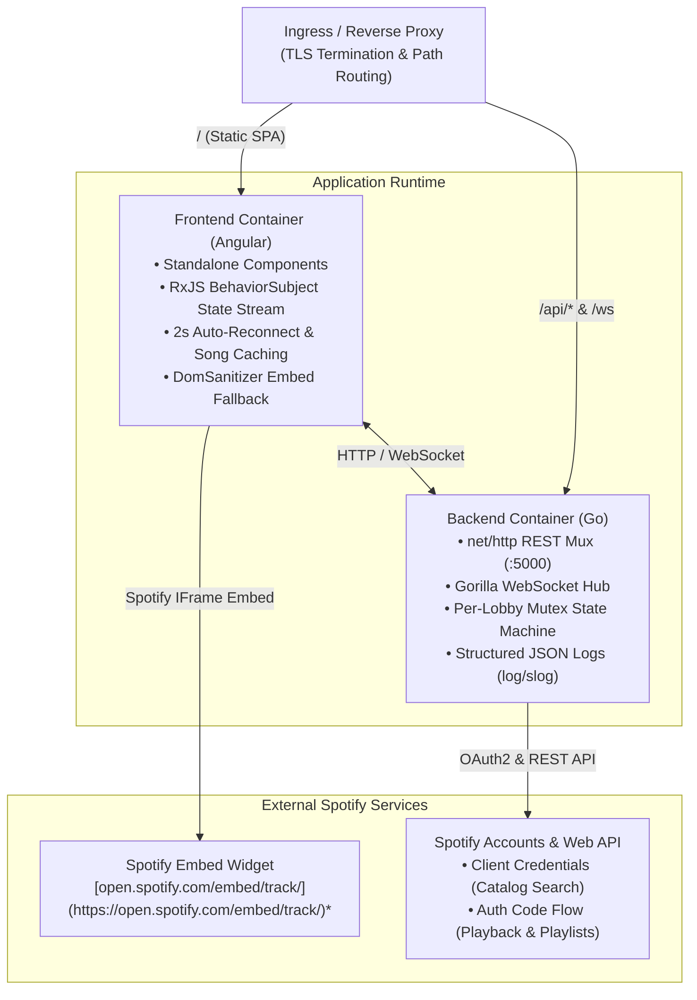
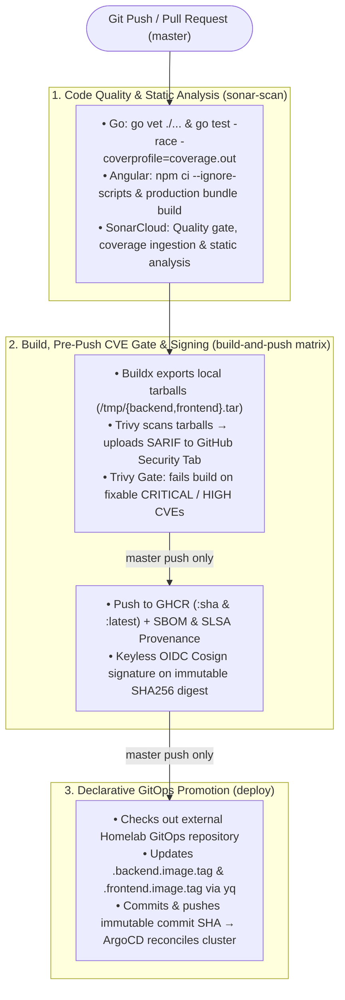
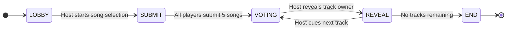

# Spotify Wrapped Game

[](https://github.com/jakubswi/Spotify-Wraped-Game/actions/workflows/pipeline.yaml)
[](./backend)
[](./frontend)
[](#cicd-devsecops--gitops-pipeline)
[](#cicd-devsecops--gitops-pipeline)

> **A real-time multiplayer music guessing game built with Go and Angular, backed by an end-to-end DevSecOps CI/CD pipeline, Sigstore image signing, and ArgoCD GitOps delivery.**

Players join a shared lobby, secretly submit five tracks from Spotify, and vote on who picked each mystery song as tracks are shuffled and played back in real time. At the end of the match, the engine crowns the top **Taste Maker** and automatically compiles the room's soundtrack into a private Spotify playlist.

---

## Table of Contents

1. [System & Runtime Architecture](#system--runtime-architecture)
2. [CI/CD, DevSecOps & GitOps Pipeline](#cicd-devsecops--gitops-pipeline)
3. [Engineering Decisions & Trade-offs](#engineering-decisions--trade-offs)
4. [Gameplay & Deterministic State Machine](#gameplay--deterministic-state-machine)
5. [API & WebSocket Protocol](#api--websocket-protocol)
6. [Project Directory Structure](#project-directory-structure)
7. [Configuration & Local Development](#configuration--local-development)

---

## System & Runtime Architecture



### Backend Concurrency & Resilience (`backend/main.go`)

* **Fine-Grained Locking:** Global lobby (`sync.Mutex`), user session (`sync.RWMutex`), and app token (`sync.RWMutex`) registries are decoupled from individual `Lobby` instances—each lobby owns an isolated `sync.Mutex` so active games never contend on a global lock.
* **Non-Blocking WebSocket Fan-Out:** Each connected player receives a dedicated buffered outbound channel (`chan interface{}`, capacity `256`) serviced by a `writePump` goroutine with a **10-second write deadline**. Slow or stalled clients drop frames rather than blocking state broadcasts for the rest of the room.
* **Heartbeat & Disconnect Grace Period:** Connections enforce a **25-second ping ticker** and **60-second pong read deadline**. If all players disconnect mid-game (`SUBMIT`, `VOTING`, `REVEAL`), a `2-minute` `time.AfterFunc` grace timer preserves the lobby state for seamless reconnection; empty `LOBBY` rooms are garbage-collected immediately.
* **Dual OAuth2 Token Lifecycle:**
  * **Application Scope (`Client Credentials`):** Cached in memory with a 60-second pre-expiry refresh buffer, allowing unauthenticated guests to search Spotify's track catalog.
  * **Host Scope (`Authorization Code`):** Protected with `HttpOnly`, `SameSite=Lax` CSRF state (`spotify_oauth_state`) and session (`spotify_session`) cookies, handling automatic `refresh_token` rotation for Spotify Connect playback (`PUT /v1/me/player/play` & `/pause`) and batched playlist creation (`POST /v1/me/playlists`).
* **Cloud-Native Secret Resolution:** Reads credentials from mounted secret files (`/run/secrets/<NAME>`) first, falling back to environment variables for local development.

### Frontend Architecture (`frontend/src/app/`)

* **Standalone Angular Architecture:** Built with standalone components (`AppComponent`, `GameComponent`) and reactive RxJS state streams (`BehaviorSubject<GameState | null>`).
* **Resilient Reconnection & Media Continuity (`GameService`):** Automatically reconnects dropped WebSocket sessions on a **2-second backoff** and re-joins the active room. Preserves the active `current_song` object reference across mid-round `STATE_UPDATE` broadcasts (such as incoming votes) so the fallback Spotify `<iframe>` player does not reload mid-track.
* **Safe Embed Fallback (`GameComponent`):** Sanitizes track embed URLs via Angular's `DomSanitizer` when the host does not have an active Spotify Connect device.

---

## CI/CD, DevSecOps & GitOps Pipeline

Every push and pull request to `master` triggers `.github/workflows/pipeline.yaml`, enforcing static analysis, race-condition testing, pre-push CVE gating, supply-chain attestation, and decoupled GitOps deployment:



### Security & Supply-Chain Controls

| Control | Implementation | Purpose |
| :--- | :--- | :--- |
| **Action Pinning** | All `uses:` references pinned to full 40-char commit SHAs | Eliminates upstream tag-hijacking risk in CI workflows. |
| **Pre-Push Image Scanning** | Docker Buildx exports to `.tar` before `trivy-action` | Vulnerable images fail the gate *before* ever reaching GHCR. |
| **Vulnerability Gating** | `severity: CRITICAL,HIGH`, `ignore-unfixed: true`, `exit-code: '1'` | Blocks builds with actionable patched CVEs while uploading full SARIF reports to GitHub Security. |
| **Artifact Attestations** | `sbom: true`, `provenance: true` on `docker/build-push-action` | Attaches CycloneDX/SPDX SBOMs and SLSA build provenance directly to OCI manifests. |
| **Keyless Image Signing** | `cosign sign --yes <image>@<sha256-digest>` via GitHub OIDC | Cryptographically binds image digests to the workflow identity without managing static signing keys. |
| **Zero-Trust CD Boundary** | CI pushes tag updates to an external GitOps repo via `yq` | GitHub Actions holds **zero Kubernetes credentials**; ArgoCD pulls and reconciles state inside the cluster. |
| **Concurrency Guardrails** | `cancel-in-progress: ${{ github.ref != 'refs/heads/master' }}` | Cancels superseded PR builds immediately while protecting `master` rollouts from race conditions. |

---

## Engineering Decisions & Trade-offs

* **In-Memory State vs. External Store:** Lobby state lives in Go memory protected by per-lobby mutexes to achieve sub-millisecond WebSocket broadcast latency without external Redis/DB dependencies. *Operational implication:* In Kubernetes, the backend runs as a single replica using a `Recreate` deployment strategy (or sticky sessions) with `/run/secrets/` volume mounts for credentials.
* **Server-Side Anti-Cheat Redaction:** Rather than relying on the frontend to hide track ownership during `VOTING`, `broadcastLobbyState` serializes a per-recipient payload and strips `current_song.owner_id` for every player except the track's submitter.
* **Structured Observability:** All backend events emit JSON logs via Go's standard `log/slog` (`slog.NewJSONHandler(os.Stdout, ...)`), ready for ingestion by Promtail/Loki or Fluent Bit without custom regex parsers.

---

## Gameplay & Deterministic State Machine

### State Machine Flow



### Game Phases

1. **Create or Join a Room (`LOBBY`):** Players enter a **Room Code** (up to 16 chars, auto-uppercased) and **Username** (up to 20 chars). The first player becomes **Host** and can link their Spotify account for automated playback and playlist generation.
2. **Secret Track Selection (`SUBMIT`):** Players search Spotify's catalog and lock in **exactly 5 tracks**.
3. **Mystery Track & Voting (`VOTING`):** The backend shuffles all submissions into a master queue and triggers playback on the host's active Spotify Connect device (with an embedded mini-player fallback). Non-owners vote on who submitted the track.
4. **The Reveal (`REVEAL`):** Host stops playback and reveals the submitter. Correct guesses award **+100 points**, and all individual votes are displayed.
5. **Final Scoreboard & Playlist (`END`):** Players are ranked by score to crown **The Taste Maker**, and a link to the newly created private Spotify playlist (`Wrapped Game - Room <CODE>`) is published on screen.

---

## API & WebSocket Protocol

### HTTP Endpoints

| Method | Endpoint | Description |
| :--- | :--- | :--- |
| `GET` | `/api/health` | Liveness/readiness probe returning `{"status": "healthy"}`. |
| `GET` | `/api/lobbies` | Lists active rooms with ID, host, connected player count, and state. |
| `GET` | `/api/spotify/search?q=<query>` | Queries Spotify track search (limit 10) using the cached Client Credentials token. |
| `GET` | `/api/spotify/login` | Generates CSRF state cookie and redirects host to Spotify OAuth2 `/authorize`. |
| `GET` | `/api/spotify/callback` | Validates CSRF state, exchanges auth code for tokens, and sets `spotify_session`. |
| `GET` | `/api/spotify/status` | Validates session cookie (refreshing access token if expired) and returns auth status. |

### WebSocket Protocol (`/ws`)

#### Client-to-Server Messages

| Action | Sender | Payload Fields | Description |
| :--- | :--- | :--- | :--- |
| `JOIN_LOBBY` | Any | `lobby_id`, `username` | Joins an existing room or initializes a new room as host. |
| `START_SUBMISSION` | Host | — | Transitions room from `LOBBY` to `SUBMIT`. |
| `SUBMIT_SONGS` | Any | `songs` (`Song[]`) | Locks in the player's 5 selected tracks. |
| `START_GAME` / `NEXT_SONG` | Host | — | Shuffles tracks (and creates the Spotify playlist on game start) or advances rounds. |
| `PLAY_CURRENT` | Host | — | Retries Spotify Connect playback for `current_song`. |
| `CAST_VOTE` | Non-Owner | `player` | Records a guess for the active track's submitter. |
| `REVEAL_SONG` | Host | — | Pauses host playback, awards +100 pts per correct guess, and enters `REVEAL`. |

#### Server-to-Client Broadcast (`STATE_UPDATE`)

Broadcast on every membership, phase, vote, or playback state transition:
* `state`: `'LOBBY' | 'SUBMIT' | 'VOTING' | 'REVEAL' | 'END'`
* `round`, `host`, `host_spotify_connected`, `playlist_url`, `playback_error`
* `current_song`: Track metadata (`owner_id` redacted for non-owners during `VOTING`)
* `players`, `connected_players`, `submitted_players`, `voted_players`, `scores`
* `votes`: Included only during `REVEAL` and `END` phases

---

## Project Directory Structure

```text
spotify-wrapped-game/
├── .github/
│   ├── workflows/
│   │   └── pipeline.yaml            # CI/CD: SonarCloud, Trivy, SBOM, Cosign & ArgoCD GitOps
│   └── dependabot.yml               # Automated weekly dependency updates (Go, npm, Docker, Actions)
├── backend/
│   ├── go.mod
│   ├── go.sum
│   └── main.go                      # HTTP/WebSocket server, state machine & Spotify OAuth2 client
├── docker/
│   ├── backend/
│   │   └── Dockerfile               # Multi-stage Go backend container build
│   └── frontend/
│       └── Dockerfile               # Multi-stage Angular + Nginx static container build
├── frontend/
│   ├── package.json
│   └── src/app/
│       ├── app.component.ts         # Root standalone component
│       ├── game/
│       │   ├── game.component.ts    # Game UI state machine, voting & DomSanitizer embed logic
│       │   └── game.component.html  # Multi-stage views (Entry, Lobby, Submit, Voting, Reveal, End)
│       └── services/
│           ├── game.service.ts      # WebSocket lifecycle, auto-reconnect & BehaviorSubject stream
│           └── spotify.service.ts   # HTTP client for Spotify search & OAuth status/login
└── sonar-project.properties         # SonarCloud project, exclusions & Go coverage configuration
```

---

## Configuration & Local Development

### 1. Spotify Developer App Setup

1. Create an application in the [Spotify Developer Dashboard](https://developer.spotify.com/dashboard).
2. Register your callback URL under **Redirect URIs** (e.g., `http://localhost:4200/api/spotify/callback` or your production ingress domain).
3. Request the following OAuth2 scopes (automatically handled by `/api/spotify/login`):
   * `playlist-modify-private`, `playlist-modify-public`
   * `user-modify-playback-state`, `user-read-playback-state`, `streaming`

### 2. Environment Variables & Mounted Secrets

| Secret / Env Variable | Required | Description |
| :--- | :--- | :--- |
| `CLIENT_ID` | Yes | Spotify Application Client ID (read from `/run/secrets/CLIENT_ID` or env). |
| `CLIENT_SECRET` | Yes | Spotify Application Client Secret (read from `/run/secrets/CLIENT_SECRET` or env). |
| `SPOTIFY_REDIRECT_URI` | Optional | Explicit OAuth callback URL (auto-inferred from `X-Forwarded-Proto` / `Host` if omitted). |

### 3. Running Locally

**Start the Go Backend (Port `5000`):**

```bash
cd backend
export CLIENT_ID="your_spotify_client_id"
export CLIENT_SECRET="your_spotify_client_secret"
go run main.go
```

**Start the Angular Frontend:**

```bash
cd frontend
npm ci
npm start
```

*(Configure your Angular dev-server proxy or local reverse proxy to forward `/api` and `/ws` to `http://localhost:5000`.)*